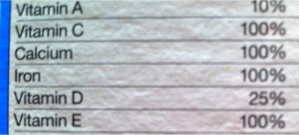
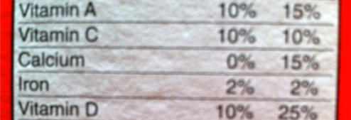
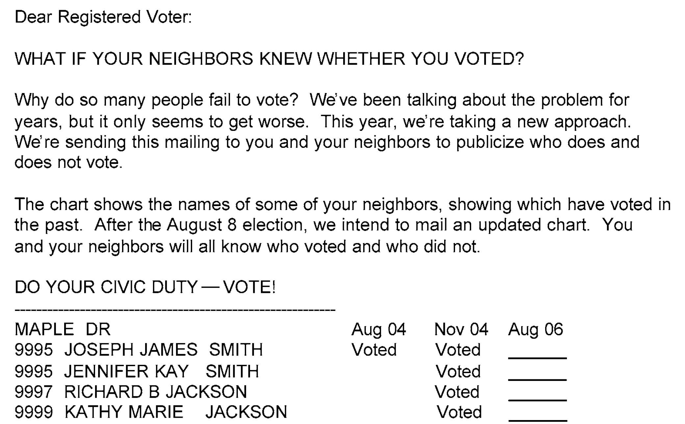
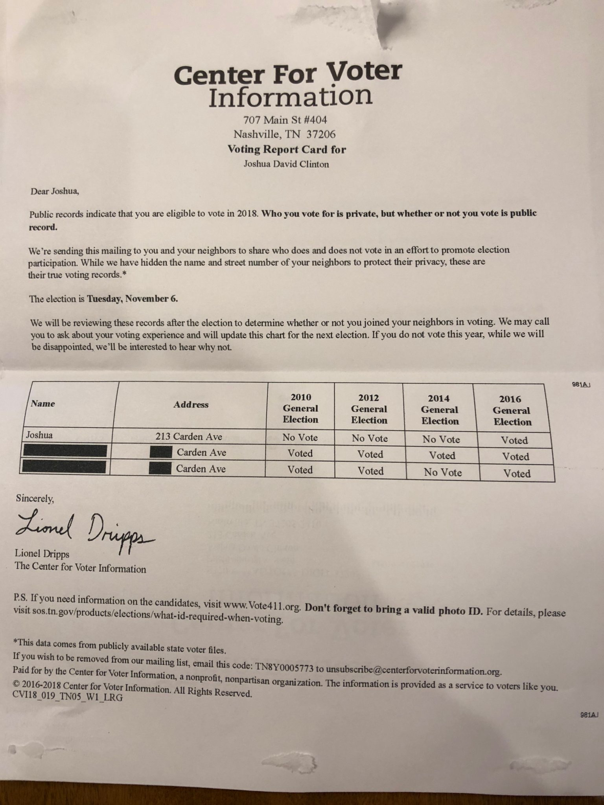
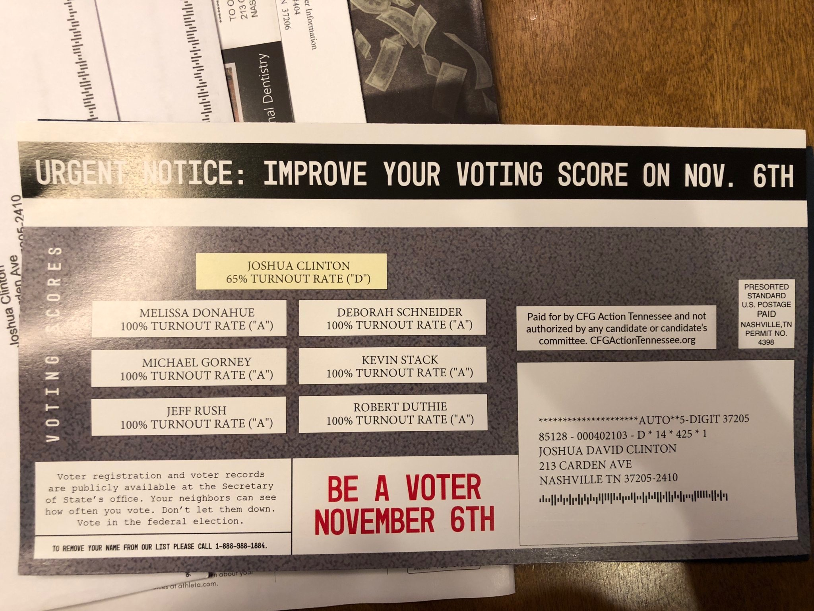

```{r setup, include=FALSE}
knitr::opts_chunk$set(eval = FALSE, echo = TRUE, message = FALSE, warning = FALSE)
```

# Today's Agenda: Learning Objectives

- Four Types of Questions

- _Fundamental Problem of Causal Inference_

- Randomized Controls: Treatment vs. Control, Effect of Randomization

- Sample Average Treatment Effect (SATE)

- Threats to Causal Inference: Placebo Effect, Hawthorne Effect, Double Blind Studies

- Internal Validity vs. External Validity

- Estimating the Sample Average Treatment Effect in `R`

- What increases turnout?

# Four Types of Questions

1. What does the world look like? **Description**

    e.g., What is the age distribution of voters? How worried are partisans about the pandemic? What is presidential approval?

2. Given X what do I predict will happen? **Univariate Prediction**

    e.g., Given poll results on self-reported vote choice, who will win?

3. Given an existing relationship between independent variable X and dependent variable Y, if I get new information about X what should I predict will happen with Y? **Conditional Prediction**

    e.g., Given trends in poll results (Y) over time (X), what do I predict will happen in the future?

4. Do changes in X cause changes in Y? **Causality**

## Our Toolbox of Answers (so far)

1. What does the world look like? **Description**

    `ggplot`, `summary`, `count`, `summarize`

2. Given X what do I predict will happen? **Univariate Prediction**

    Typical (Expected) Value: `mean`, `median`, mode (`count`)

3. Given an existing relationship between independent variable X and dependent variable Y, if I get new information about X what should I predict will happen with Y? **Conditional Prediction**

    Typical (Expected) Value using: `group_by`, `filter`; Regression (to come)

4. Do changes in X cause changes in Y? **Causality**

# What I Ate for Breakfast Today

<div style="text-align:center">


</div>

## I'm bored. Does It Stick to a Magnet?

Yup!!

<div style="text-align:center">

</div>

## OK, but Why?

<div style="text-align:center">


</div>

## No Stick!!

<div style="text-align:center">

</div>

# Conceptualizing Causal Effects: (Rubin Causal Model)

- **Unit**: Cereal? (but “Flake” (within-cereal)?)

- **Treatment variable** (causal variable of interest) $T$: Iron? (but Vitamin C? Calcium?)

- **Treatment group** (Treated Units): *Total*

- **Control group** (Untreated Units): *Honey Smacks*

- **Outcome variable** (response variable) $Y$: Does cereal stick to a magnet?

THINKING IS IMPORTANT! Role of theory in identifying outcomes of interest? Possible causal relationships?

## KEY IDEA: Causality via Counterfactuals

- What does “$T$ causes $Y$” mean? $\rightsquigarrow$ **counterfactual**, “What If”

- Would *Total* (Unit) stick to a magnet (Outcome) if it did not have iron (Treatment)?

- For unit $i$, two **potential outcomes**: $Y_i(T==1)$ and $Y_i(T==0)$

- **Causal effect**: $Y_i(T==1) - Y_i(T==0)$

- **Fundamental Problem of Causal Inference**: for every unit $i$ we can only ever observe either $Y_i(T==1)$ (if they received treatment) or $Y_i(T==0)$ (if they did not)! Not both!

Causality is a comparison between factual and counterfactual situations, but the world is as the world is and we are never able to observe the counterfactual (absent using the Tardis or some such device).

## More Data? Big Data to the Rescue?

<div style="text-align:center">

</div>

More **of the same type of data** won't increase our ability to estimate this difference!

## So We Need to Think? Sadly, Yes. A Lot.

Find a "similar" unit! $\rightsquigarrow$ **Matching**

*Honey Smacks* are too different from *Total* to identify the source of the difference in the outcome.

Find another cereal identical to *Total* in terms of *everything* (i.e., texture, shape, ingredients) **except** the treatment of interest -- iron.

- **Confounders**: variables that possibly affect the outcome of interest.

- May also have unobserved **confounders**: variables (characteristics) associated with both the Treatment and Outcome $\rightsquigarrow$ **selection bias**.

    Effect of exercise on health? Is something causing both exercise and health?

Problem: It is near impossible to match on every possible confounder. Some confounders may be unobserved or unmeasurable.

# A Solution: Randomized Controlled Trials

Randomize! (If possible!)

Randomization of the treatment makes the treatment and control groups “identical” **on average**.

On average, the two groups are similar in terms of *all* (observed and unobserved) characteristics.

Randomized experiments are the gold standard.

## Estimated Causal Effect? SATE

Use difference in average outcome between the two groups to estimate **Sample Average Treatment Effect** (SATE).

For observation $i$ belonging to either the Treatment ($T_i==1$) or Control ($T_i==0$) and observed outcome $Y_i$, if $n_t$ and $n_c$ observations are in the Treatment and control groups respectively:

$$
\begin{aligned}
\textsf{SATE} &= \frac{1}{n} \sum_{i=1}^n \{Y_i(T==1) - Y_i(T==0)\} \\
\textsf{Difference\ of\ Means} &= \frac{1}{n_t} \sum_{i=1}^{n_t} Y_i(T_i==1) - \frac{1}{n_c} \sum_{j=1}^{n_c} Y_j(T_j==0)
\end{aligned}
$$

The SATE is simply the **average** differences between the treatment and control is the (average) effect we can attribute to the Treatment if we assume that randomization is able to ensure that all else is equal!

## Threats to Randomized Control Trial

- **Placebo effect (1)**: If the *researcher* knows if unit/subject is in treatment or control it may affect the outcome (or measurement of the outcome).

- **Placebo effect (2)**: If the *unit/subject* thinks they are taking the treatment and changes their behavior in response (e.g., sugar pill).

- **Hawthorne Effects**: If the *unit/subject* knows they are being studied/watched that may affect the outcome. (Effect of being studied changes their behavior.)

- **Double-blind experiments**: Neither researchers nor subjects know if they are in treatment or control condition.

## Evaluating a Research Design: More thinking!

**Internal Validity:** Do you believe the results **for the study for the sample being analyzed**?

**External Validity:** Do the results generalize **beyond the sample being analyzed**?

RCTs often have good internal validity (due to randomization), but questionable external validity (due to the manipulation being done).

Observational analyses (coming), have good external validity, but troubling internal validity (due to confounders).

# Social Pressure Experiment

<div class="alert alert-info">
**MOTIVATION QUESTION**
How to mobilize voters?
</div>

August 2006 Primary Statewide Election in Michigan

Randomly select registered voters from the voter file and send postcards with different, randomly assigned, messages:

- No message (Control Group)
- Civic duty message
- “You are being studied” message (*Hawthorne Effect*)
- Neighborhood social pressure message

<div style="text-align:center">

</div>

## Now Common...

<div style="text-align:center">

</div>

## "Free of intimidation of any kind..."

<div style="text-align:center">

</div>

## Very Common...

<div style="text-align:center">

</div>

## What Is the Research Design?

Before looking at the results:

1. What is a unit?
2. What is the treatment?
3. What is the control?
4. What is the outcome?
5. What comparison estimates the causal effect?

## Reading in Data and Getting Ready

The data we have includes the following variables:

| Name | Definition |
|---|---|
| `messages` | GOTV message voter received: "Civic Duty", "Control", "Neighbors", "Hawthorne" |
| `primary2004` | whether a voter turned out in the 2004 Primary election (1 = "Yes" 0 = "No") |
| `primary2006` | whether a voter turned out in the 2006 Primary election (1 = "Yes" 0 = "No") |
| `yearofbirth` | year of birth of voter |
| `sex` | sex of voter |
| `hhsize` | household size of voter |

As always, load in our data -- here a comma separated file `*.csv` -- and inspect:

```{r}
library(tidyverse)

social = read.csv("social.csv")
glimpse(social)

social |>
  count(messages) |>
  mutate(Pct = n / sum(n))
```

What is an observation in these data?

## Did Randomization Work?

The key principle in Random Control Trials is randomization. That is what allows us to estimate the SATE and attribute all of the average difference between groups to the treatment itself. Randomization ensures **balance** across groups in our sample in both observable and unobservable characteristics.

One important threat here is whether some people were more likely to vote than others and whether those that were more likely to vote were more likely to get one of the treatment messages. If so, we could not determine if differences in turnout was related to the experiment or preexisting differences.

To check this let us compare the past voting behavior of the various groups. In particular, to check the randomization of the treatment `messages`, we can compare the average past voting behavior in each group using a similar election: `primary2004`.

```{r}
social |>
  group_by(messages) |>
  summarize(PctVote2004Primary = mean(primary2004, na.rm = TRUE))
```

So no differences. Checking the randomization is a key component for assessing *internal validity* -- if the randomization failed then the internal validity is compromised.

What is another variable that might matter and why? Can you check the randomization for that as well?

*Quick Exercise* Check randomization of another variable. Why is it important to check that?

```{r}
# INSERT CODE HERE
```

## Now doing the work to estimate causal effect

Now let's figure out how to use R to identify the effect of the various messages. As we discussed, the Sample Average Treatment Effect (SATE) is simply the difference in the average outcome for the treatment and control. Here we have 3 different treatments so we calculate the average difference for each.

So let us look at our outcome of interest `primary2006` by Treatment group `messages` using `group_by`:

```{r}
AvgTurnout = social |>
  group_by(messages) |>
  summarize(AvgVote2006 = mean(primary2006, na.rm = TRUE))

AvgTurnout
```

*Quick Exercise* Are the quantities we just computed the SATE?^[No. It is the average outcome. To get the SATE we need to subtract the average outcome in the Control group from these quantities.]

### Plotting a Statistic Rather than Raw Data

Suppose that we want to visualize this. Before we were graphing raw data and `ggplot` was summarizing the data when creating the plot (e.g., counting how many observations take on each value when creating a barplot, or how many fall within some bin-width in a histogram). But if we have already done the calculations and we want to plot a statistic (i.e., a function of the data) rather than the data itself we need to tell `ggplot` this. We do so by using the `stat = "identity"` setting in our `geom` to tell R that we are giving it values that we want to plot and that R does not need to do any processing of the data to create the visualization.

So in this case we have already computed the average turnout for each group and we just want to plot that. We can use the object of means we just created, `AvgTurnout`, and then create a plot using those results.

```{r}
AvgTurnout |>
  ggplot(aes(x = messages, y = AvgVote2006)) +
  geom_bar(stat = "identity") +
  labs(x = "Postcard Message",
       y = "Percent Voting in 2006 Primary",
       title = "Social Pressure Experiment: Michigan 2006 Primary") +
  scale_y_continuous(labels = scales::percent_format(accuracy = 1)) +
  theme_bw()
```

## Calculate the Treatment Effects

To calculate the SATE we need to subtract the average value in the Control group from the average outcome in the Treatment groups. So let us define the average turnout in the Control group for use later.

```{r}
ControlTurnout = AvgTurnout |>
  filter(messages == "Control") |>
  pull(AvgVote2006)

TreatmentEffects = AvgTurnout |>
  mutate(SATE = AvgVote2006 - ControlTurnout)

TreatmentEffects
```

NOTE: using `select(AvgVote2006)` would keep a one-row data frame; `pull(AvgVote2006)` returns just the number that we need for the subtraction in `mutate()`.

We can tell this works because the value for the "Control" group is 0!

This gives us the *percentage point change* in turnout relative to the control.

What does the estimate for the neighborhood message mean in percentage **points**?

We could also calculate the *percent change* using the fact that the Control group gives us the baseline turnout.

```{r}
AvgTurnout |>
  mutate(PctChange = 100 * (AvgVote2006 - ControlTurnout) / ControlTurnout)
```

This tells you how much larger (or smaller) turnout is relative to baseline. Why is that different from the percentage point change?

### Plot the Estimated Effects

*Quick Exercise* Instead of printing a table to the screen, can you instead create a visualization of the effect? What do you need to do? Does it make sense to drop the control group from the visualization? If so, how can you do this?

```{r}
# INSERT CODE HERE
```

One way to do this is:

```{r}
TreatmentEffects |>
  filter(messages != "Control") |>
  ggplot(aes(x = reorder(messages, SATE), y = SATE)) +
  geom_col(fill = "purple") +
  coord_flip() +
  labs(
    x = "Postcard message",
    y = "Percentage Point Change in turnout relative to control",
    title = "Estimated Effect of Each Postcard Message"
  ) +
  scale_y_continuous(labels = scales::percent_format(accuracy = 1)) +
  theme_bw()
```

## Are These Differences Statistically Distinguishable?

To determine this, we can use resampling! We observe one experiment. What would happen if a different sample of voters had been assigned to the experiment?

```{r}
set.seed(42)
n_iterations = 1000
Control_means = NULL
CivicDuty_means = NULL
Hawthorne_means = NULL
Neighbors_means = NULL

for (i in 1:n_iterations) {
  sampC = social |>
    filter(messages == "Control") |>
    slice_sample(prop = 1, replace = TRUE) |>
    summarize(AvgC = mean(primary2006))

  Control_means = bind_rows(Control_means, sampC)

  sampCD = social |>
    filter(messages == "Civic Duty") |>
    slice_sample(prop = 1, replace = TRUE) |>
    summarize(AvgCD = mean(primary2006))

  CivicDuty_means = bind_rows(CivicDuty_means, sampCD)

  sampH = social |>
    filter(messages == "Hawthorne") |>
    slice_sample(prop = 1, replace = TRUE) |>
    summarize(AvgH = mean(primary2006))

  Hawthorne_means = bind_rows(Hawthorne_means, sampH)

  sampN = social |>
    filter(messages == "Neighbors") |>
    slice_sample(prop = 1, replace = TRUE) |>
    summarize(AvgN = mean(primary2006))

  Neighbors_means = bind_rows(Neighbors_means, sampN)
}

SampledData = bind_cols(Control_means, CivicDuty_means,
                         Hawthorne_means, Neighbors_means)
glimpse(SampledData)
```

Now let's compute the SATE for each iteration so that we can then summarize the variation in SATE across the resampled data.

```{r}
SampledData = SampledData |>
  mutate(SATE_CD = AvgCD - AvgC,
         SATE_H = AvgH - AvgC,
         SATE_N = AvgN - AvgC)

glimpse(SampledData)
```

Now we can quantify our uncertainty using the `quantile` function:

```{r}
SummarySATE = SampledData |>
  summarize(CD_SATE = mean(SATE_CD),
            p025_CD = quantile(SATE_CD, .025),
            p975_CD = quantile(SATE_CD, .975),
            H_SATE = mean(SATE_H),
            p025_H = quantile(SATE_H, .025),
            p975_H = quantile(SATE_H, .975),
            N_SATE = mean(SATE_N),
            p025_N = quantile(SATE_N, .025),
            p975_N = quantile(SATE_N, .975))

SummarySATE
```

Which reveals that the Sample Average Treatment Effect for the "Neighbors" social pressure message is 0.081 with a 95% confidence interval that ranges from 0.076 to 0.086. So it looks like the Neighbors treatment had a sizable effect that is well above 0!

Can we determine the probability that the Hawthorne messages -- people aware that they were being studied -- had a greater impact than the Civic Duty messages?

```{r}
SampledData |>
  mutate(HbiggerCD = if_else(SATE_H > SATE_CD, 1, 0)) |>
  summarize(PctGreater = mean(HbiggerCD))
```

So almost certainly yes!

*Quick Exercise* What is the probability that the percentage point change as a result of social messages is greater than 8 percentage points?

```{r}
# INSERT CODE HERE
```

Stepping back, *do you believe this*? An 8 percentage point increase in turnout is a huge effect!

What are some threats to external validity? What are some threats to internal validity?

# What Can We Conclude?

Randomization gives us a credible comparison because treatment and control groups should be comparable _on average_.

But we still have to think:

- Was the treatment actually delivered or taken up?
- Was the outcome measured well?
- Did people respond to being studied?
- Did units affect one another?
- Does the result generalize beyond the sample and the treatment studied?
- Is the estimated effect substantively important?

# New R Functions Introduced in Session 13

Functions introduced in earlier sessions are intentionally omitted.

| Function or symbol | What it does |
|---|---|
| `pull()` | Extracts one column from a data frame as a plain vector of values. |
| `stat = "identity"` | Tells a `geom` to plot the values as given rather than counting or binning them. |
| `geom_col()` | Draws bars whose heights are values already in the data. |
| `reorder()` | Orders the values of a variable by another variable, for example to sort bars by size. |
| `bind_cols()` | Combines data frames by adding columns side by side. |

# Works Cited

Gerber, Alan S., Donald P. Green, and Christopher W. Larimer. 2008. “Social
Pressure and Voter Turnout: Evidence from a Large-Scale Field Experiment.”
*American Political Science Review* 102 (1): 33–48.
[https://doi.org/10.1017/S000305540808009X](https://doi.org/10.1017/S000305540808009X).
