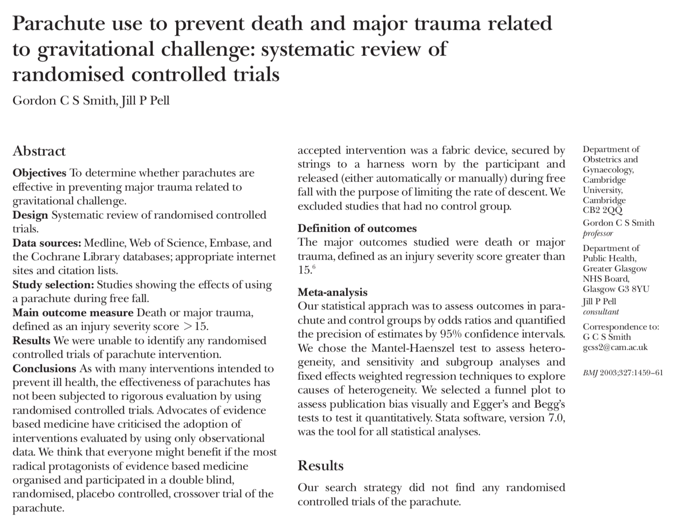
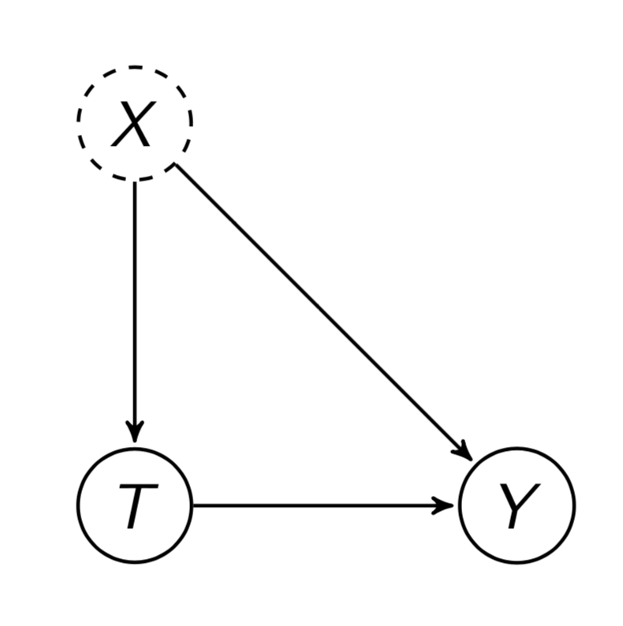
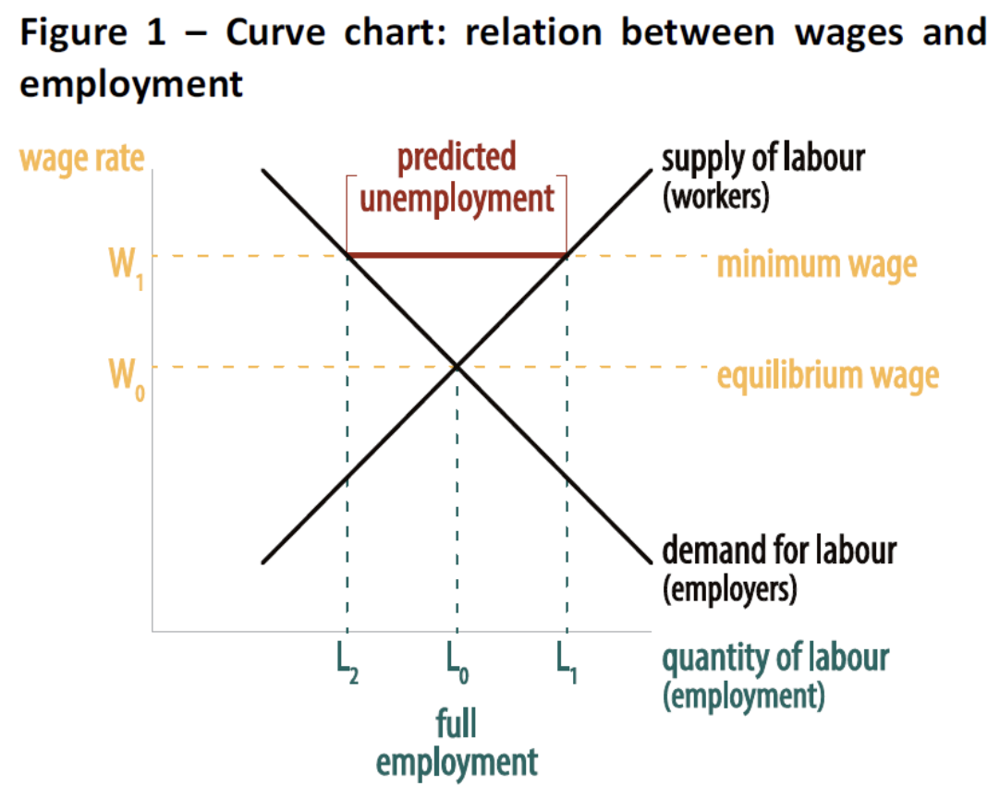
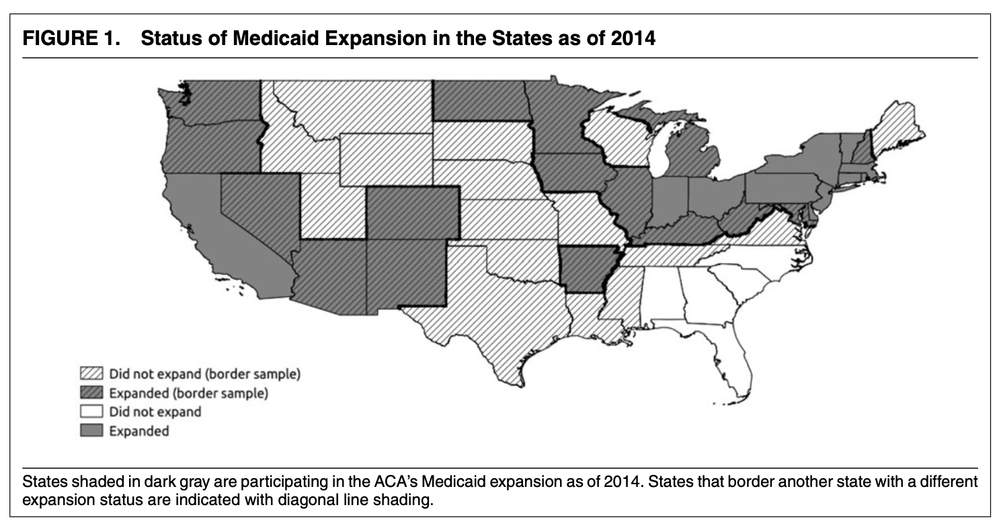

```{r setup, include=FALSE}
knitr::opts_chunk$set(eval = FALSE, echo = TRUE, message = FALSE, warning = FALSE)
```

# Today's Agenda: Learning Objectives

Three motivating questions:

- Did playing without fans reduce home-field advantage?

- Does raising the minimum wage reduce full-time employment?

- How does health care affect politics?

Tools:

- Observational studies: _internal_ vs. _external validity_

- _Confounding_ and _selection bias_

- Causality by design: _cross-section_, _before-and-after_, and _difference-in-differences_


# Evaluating a Research Design

- **Internal Validity**: Do you believe the results *for the study for the sample being analyzed*?

- **External Validity**: Do the results generalize *beyond the sample being analyzed*?

## Necessity of Observational Studies

Much of the time the questions we are interested in cannot be randomized. Restricting ourselves to Randomized Control Experiments can be *very limiting* in terms of the questions we can ask. Questions about external validity arise -- how confident are we that the effects generalize?

This has caused lots of discussion -- especially in medical studies (e.g., "evidence based medicine"). Consider the following parody -- full article in Brightspace.

<div style="text-align:center">
{width=55%}
</div>

Often, we cannot randomize treatment for ethical and logistical reasons: e.g., smoking and lung cancer.

**Observational studies**: studies in which the treatment is “naturally” assigned.

Often better *external validity* for generalization beyond experiments -- because we are looking at actual behavior and outcomes as they occur in the actual world, but the trade-off is often (much?) weaker *internal validity*!

Why?

The treatment and control groups may be very different. The assumption of “all else equal” becomes very hard in the absence of randomization! (Which is why we love randomization.)

## Confounding and Selection Bias

Pre-treatment variables may differ between treatment and control groups and this can impact our ability to attribute differences in outcomes to the treatment of interest. These differences can take several forms:

- **Confounding bias**: Differences in the outcome between treatment and control is due to differences in other variables/characteristics besides the treatment variable of interest.

- **Selection bias**: The observations who are in the treatment self-select into the treatment and they are therefore different from the control by virtue of that self-selection. They chose to take the Treatment and the others did not and this may be related to other differences between the groups.

To deal with the related issues of **confounding** and **selection bias** we often rely on the use of *statistical controls* to try to make "all else equal comparisons." This is where regression comes into play. (More on this later!) Even so, we may worry about the impact of *unobserved (and unmeasurable) confounding*. What happens if we think the treatment and control may vary in ways that are not easily measurable?

Key assumption of interpreting a difference in terms of a causal effect is **Unconfoundedness**: treatment and control groups comparable with respect to *everything* other than treatment!

But this can be problematic. e.g., Do Hospital Visits (T) cause Death (Y)?

How can we find a good comparison group to evaluate this?

A closely-related issue is the issue of **selection effects**: when some other variable affects both the outcome and the control. These situations are especially pernicious when the selection is based on unobservable or unmeasurable characteristics.

<div style="text-align:center">
{width=42%}
</div>

For example, if we want to compare the effect of a change in a law on outcomes -- e.g., expanding Medicaid under the Affordable Care Act, restricting abortion -- we may worry that the states that change the law differ in fundamental ways from those that do not in ways that make it difficult/impossible to assume that "all else equal" when attributing differences in outcomes to differences in Treatment.

In theory, if we can identify all of the possible differences and account for them -- via *statistical controls* -- we may be willing to assume that "all else equal." If so, we can then attribute any difference to differences in Treatment. This is a **critical thinking** task that requires an argument!

Even so, it may be impossible to identify and measure all of the possible sources of difference that may affect either the decision to self-select into the Treatment (e.g., change the law) and/or how the law may affect outcomes in that state given between-state differences (i.e., the problem of confounding).

**You cannot fix with statistics what you screw up with design.**

## What Comparison Are We Making?

For each application, ask:

1. What is the question?
2. What is a unit?
3. What is the treatment?
4. What is the outcome?
5. What is the control or comparison group?
6. What else differs across the units or periods being compared?
7. What must be true to interpret the difference causally?
8. What can we actually conclude?

# Home-Field Advantage?

<div class="alert alert-info">
**MOTIVATION QUESTION**
Did playing without fans reduce home-field advantage?
</div>

The 2019–20 German Bundesliga season stopped in March 2020 because of COVID-19. When play resumed on May 16, matches were played without fans.

Home teams had fans before the shutdown and no fans after the shutdown.

What do you predict will happen to home-field advantage?

## Read and Inspect the Bundesliga Data

Each row is one of the 306 matches of the 2019–20 season.

| Variable | What it measures |
|---|---|
| `Date` | Date of the match |
| `HomeTeam`, `AwayTeam` | The two teams |
| `FTHG`, `FTAG` | Full-time goals scored by the home team and the away team |
| `FTR` | Full-time result: `H` (home win), `D` (draw), `A` (away win) |
| `Crowd` | `Fans` for matches before the shutdown; `No fans` for matches on or after May 16, 2020 |
| `HomeWin` | 1 if the home team won, 0 otherwise |
| `GoalDifference` | Home goals minus away goals |

```{r}
library(tidyverse)

bundesliga = read.csv("bundesliga.csv")

glimpse(bundesliga)
```
What is an observation?

What are the treatment and outcome variables?

## A Before-and-After Comparison

```{r}
BundesligaComparison = bundesliga |>
  group_by(Crowd) |>
  summarize(
    Matches = n(),
    PctHomeWin = mean(HomeWin),
    AvgHomeGoals = mean(FTHG),
    AvgAwayGoals = mean(FTAG),
    AvgGoalDifference = mean(GoalDifference)
  )

BundesligaComparison
```

```{r}
BundesligaComparison |>
  ggplot(aes(x = Crowd, y = PctHomeWin)) +
  geom_col() +
  labs(
    x = "Crowd Type",
    y = "Percent Matches won by home team",
    title = "Home Wins Before and After Bundesliga Play Resumed"
  ) +
  theme_bw()
```

Home teams won less often after play resumed without fans. Does that mean the absence of fans **caused** the decline?

*Quick Exercise* Only 82 matches were played without fans. Resample the data to see whether the difference in the percentage of home wins between matches with and without fans is distinguishable from zero. Draw 1,000 bootstrap samples of the matches with fans and of the matches without fans, calculate the difference in the percentage of home wins each time, and report the 2.5th, 50th, and 97.5th percentiles. Does the interval include zero? Even if it does not, does that settle the causal question?

```{r}
# INSERT CODE HERE
```

## What Is Missing?

We have a before-and-after comparison, but no untreated comparison group.

What else changed across the shutdown?

*Fundamental Problem of Causal Inference*: what would have happened to home-field advantage over the same period if fans had remained?

The data do not contain that counterfactual. This is an interesting comparison, but the causal conclusion requires an _argument_.

# Three Identification Strategies

## 1. Before-and-after comparison

Compare the same units before and after the treatment.

*Assumption:* nothing else changed over time that would affect the outcome.

*Problem:* Things change over time -- i.e., time-varying confounding.

## 2. Cross-section comparison

Compare treated units with control units after the treatment.

*Assumption:* the treated and control units are comparable.

*Problem:* Units are different in some other consequentual way -- i.e., unit-specific confounding.

## 3. Difference-in-differences

Compare the change over time in treated units with the change over time in control units.

*Assumption:* in the absence of treatment, the groups would have followed _parallel trends_ -- i.e., changed in a similar way.

No approach is automatically best. They require different assumptions and _arguments_. What you screw up in design cannot be fixed by statistics!

# Micro 101: The Effect of the Minimum Wage on Full-Time Employment?

<div class="alert alert-info">
**MOTIVATION QUESTION**
Does raising the minimum wage reduce full-time employment?
</div>

Let us consider whether increasing the minimum wage affects full-time employment.

Micro 101 theory: the effect is negative. Imposing a wage above the equilibrium wage will result in more workers wanting to work and less willingness by firms to hire workers at that wage.

<div style="text-align:center">
{width=55%}
</div>

Empirically? VERY hard to randomize the minimum wage increase!

David Card and Alan Krueger examined fast-food restaurants in New Jersey and Pennsylvania:

- In 1992, New Jersey increased its minimum wage from \$4.25 to \$5.05.
- Neighboring Pennsylvania stayed at \$4.25.
- Employment was observed in both states before and after the increase.

## Read and Prepare the Minimum-Wage Data

Each row is one fast-food restaurant surveyed before (February–March 1992) and after (November–December 1992) New Jersey's April 1992 increase.

| Variable | What it measures |
|---|---|
| `chain` | Restaurant chain: `burgerking`, `kfc`, `roys`, or `wendys` |
| `location` | Where the restaurant is: `PA`, or one of the New Jersey regions `northNJ`, `centralNJ`, `southNJ`, `shoreNJ` |
| `wageBefore`, `wageAfter` | Starting hourly wage (dollars) in each survey wave |
| `fullBefore`, `fullAfter` | Number of full-time employees in each wave |
| `partBefore`, `partAfter` | Number of part-time employees in each wave |
| `Treatment` | `Minimum-wage increase (NJ)` for New Jersey restaurants; `No change (PA)` for Pennsylvania |
| `TotalEmploymentBefore`, `TotalEmploymentAfter` | Full-time plus part-time employees in each wave |
| `PctFullTimeBefore`, `PctFullTimeAfter` | Share of employees working full time in each wave (the outcome) |
| `ChangePctFullTime` | `PctFullTimeAfter` minus `PctFullTimeBefore` |

```{r}
minwage = read.csv("minwage.csv")

glimpse(minwage)
```

What is a unit? What is the treatment? What is the outcome?

## Did the Treatment Produce a Change?

The new minimum wage was $5.05. Was the law changing wages or simply confirming what restaurants were already paying?

```{r}
minwage |>
  mutate(
    PreAt505 = wageBefore >= 5.05,
    PostAt505 = wageAfter >= 5.05
  ) |>
  group_by(Treatment) |>
  summarize(
    PctAt505Before = mean(PreAt505),
    PctAt505After = mean(PostAt505)
  )
```

Why is it important to verify that treatment produced a change?

## Were New Jersey and Pennsylvania Comparable?

```{r}
minwage |>
  group_by(Treatment) |>
  summarize(
    Restaurants = n(),
    AvgWageBefore = mean(wageBefore),
    AvgEmploymentBefore = mean(TotalEmploymentBefore),
    PctFullTimeBefore = mean(PctFullTimeBefore)
  )
```

What confounders are missing?

## Method 1: Cross-Section Comparison

Compare New Jersey and Pennsylvania after the increase.

```{r}
CrossSection = minwage |>
  group_by(Treatment) |>
  summarize(PctFullTimeAfter = mean(PctFullTimeAfter))

CrossSection
```

What must we assume to attribute this difference to the minimum-wage increase?

## Method 2: Before-and-After Comparison

Compare New Jersey before and after the increase. First create separate tibbles for the New Jersey and Pennsylvania restaurants, since we will use each several times.

```{r}
NJ = minwage |>
  filter(Treatment == "Minimum-wage increase (NJ)")

PA = minwage |>
  filter(Treatment == "No change (PA)")
```

```{r}
BeforeAfter = NJ |>
  summarize(
    Before = mean(PctFullTimeBefore),
    After = mean(PctFullTimeAfter),
    Change = mean(ChangePctFullTime)
  )

BeforeAfter
```

What else could have changed in New Jersey between the two surveys?

## Method 3: Difference-in-Differences

```{r}
ChangesByState = minwage |>
  group_by(Treatment) |>
  summarize(Change = mean(ChangePctFullTime))

ChangesByState
```

Recall that `pull()` returns the number itself rather than a one-row data frame.

```{r}
NJChange = ChangesByState |>
  filter(Treatment == "Minimum-wage increase (NJ)") |>
  pull(Change)

PAChange = ChangesByState |>
  filter(Treatment == "No change (PA)") |>
  pull(Change)

MinimumWageDiD = NJChange - PAChange

MinimumWageDiD
```

The difference-in-differences asks whether full-time employment changed more in New Jersey than it changed in Pennsylvania.

What must be true about the trend Pennsylvania provides as the counterfactual for New Jersey?

## How Uncertain Is the Difference-in-Differences?

Resample the New Jersey restaurants and the Pennsylvania restaurants separately, calculate the difference-in-differences in each resample, and look at the distribution.

```{r}
set.seed(42)
n_iterations = 500
MinimumWageDiDSamples = NULL

for (i in 1:n_iterations) {
  NJsample = NJ |>
    slice_sample(prop = 1, replace = TRUE) |>
    summarize(Change = mean(ChangePctFullTime)) |>
    pull(Change)

  PAsample = PA |>
    slice_sample(prop = 1, replace = TRUE) |>
    summarize(Change = mean(ChangePctFullTime)) |>
    pull(Change)

  Diff = NJsample - PAsample

  MinimumWageDiDSamples = c(MinimumWageDiDSamples, Diff)
}

quantile(MinimumWageDiDSamples, c(.025, .975))
```

Does the interval include zero? Is uncertainty the only possible threat to the causal conclusion?

## Visualizing Difference-in-Differences

A picture of what the difference-in-differences is doing. The code that makes it is in the R script if you want it.

```{r, include=FALSE, eval=TRUE}
library(tidyverse)
minwage = read.csv("minwage.csv")
```

```{r, eval=TRUE, echo=FALSE}
minwage |>
  group_by(Treatment) |>
  summarize(
    Before = mean(PctFullTimeBefore),
    After = mean(PctFullTimeAfter)
  ) |>
  pivot_longer(Before:After, names_to = "Period", values_to = "PctFullTime") |>
  mutate(Period = factor(Period, levels = c("Before", "After"))) |>
  ggplot(aes(x = Period, y = PctFullTime, group = Treatment,
             color = Treatment)) +
  geom_line(linewidth = 1.2) +
  geom_point(size = 3) +
  labs(
    x = "",
    y = "Percent of employees working full time",
    color = "",
    title = "Employment Before and After the Minimum-Wage Increase"
  ) +
  scale_y_continuous(labels = scales::percent_format(accuracy = 1)) +
  theme_bw()
```

Difference-in-differences does not require the groups to begin at the same level. It requires a credible argument that they would have followed parallel trends without treatment.

Can we test that assumption with only one pre-treatment measurement?

# Revisiting How Health Care Affects Politics?

<div class="alert alert-info">
**MOTIVATION QUESTION**
How does health care affect politics?
</div>

The relationship between health care and politics in the United States is exceptionally complicated, contentious, and important.

The Democrats made the issue a priority in 2008 (again!) -- after failing in 1992 -- and they finally succeeded in passing the Affordable Care Act in 2009. The ACA sought to increase coverage, in part, by expanding Medicaid coverage to be able to insure more people -- the health care program based on poverty levels (Medicare is the program based on age). The federal government was offering financial support to cover costs associated with expansion.

Many thought that the passage of the ACA would cement Democratic majorities by giving people health care and helping solve an issue that is nearly always among the most important issues mentioned by voters.

In a 5–4 ruling, however, the Supreme Court ruled that the federal government could not mandate expansion and it was up to the states. This resulted in some states expanding Medicaid and some states choosing not to.

<div style="text-align:center">
{width=55%}
</div>

The expansion took effect on January 1, 2014.

Can we use the resulting variation to determine how health-care coverage—and the decision of Democrats to expand and Republicans to oppose—affected political outcomes?

Did it increase registration? Turnout? Support for Democrats?

We are going to examine work I did with Michael Sances.

## What Is the Research Design?

What is the treatment?

What is the control?

What is a unit?

We are looking at county-level data in our analysis -- a prospect that always raises the possibility of ecological inference errors. What can we conclude about counties? What can we conclude about individuals?

In Problem Set 4, we looked at the Oregon Medicaid lottery at the individual level. Here states selected whether to expand Medicaid, and we observe county-level outcomes. Why does that change what we need to worry about?

Each row is one county in a state whose expansion decision we observe.

| Variable | What it measures |
|---|---|
| `Treatment` | `Expand Medicaid` if the county's state expanded Medicaid in 2014; `Not Expand Medicaid` otherwise |
| `pctpoverty`, `pct65plus`, `pcths` | Proportion of county residents in poverty, aged 65 and over, and with only a high-school education (pre-treatment characteristics) |
| `lmedianincome` | Log of county median household income |
| `PresDem2012`, `PresDem2016` | Democratic share of the county's presidential vote (proportion) |
| `pcti2013`, `pcti2014`, `pcti2015` | Percent of county residents with health insurance in each year |
| `registration2012`, `registration2016` | Registered voters as a percent of the county's voting-age population |
| `dregistration20162012` | Change in registration, 2012 to 2016 (percentage points) |
| `turnout2012`, `turnout2016` | Votes cast as a percent of the county's voting-age population |
| `dturnout20162012` | Change in turnout, 2012 to 2016 (percentage points) |

```{r}
medicaid = read.csv("medicaid.csv")

glimpse(medicaid)
```

## Were Expansion and Non-Expansion Counties Comparable?

We may worry that states are fundamentally different, but what about counties that lie on either side of a state boundary?


```{r}
medicaid |>
  group_by(Treatment) |>
  summarize(
    PctPoverty = mean(pctpoverty),
    Pct65Plus = mean(pct65plus),
    PctHighSchool = mean(pcths),
    MedianIncomeLogged = mean(lmedianincome),
    PresDem2012 = mean(PresDem2012, na.rm = TRUE)
  )
```

Similar?

This tries to asses the problem of confounding. States selected whether to expand Medicaid, but does that affect the counties being compared?

## Did Expansion Change Insurance Coverage?

Treatment? Was it effective? Why is this important to check?

```{r}
medicaid |>
  group_by(Treatment) |>
  summarize(
    Coverage2013 = mean(pcti2013, na.rm = TRUE),
    Coverage2014 = mean(pcti2014, na.rm = TRUE),
    Coverage2015 = mean(pcti2015, na.rm = TRUE)
  )
```

The gap in insurance coverage grew after expansion. This is the first stage: the policy changed the treatment the argument says should matter.

## Apply the Same Three Comparisons: Registration

### Method 1: Cross-section

```{r}
medicaid |>
  group_by(Treatment) |>
  summarize(
    n = n(),
    Registration2016 = mean(registration2016, na.rm = TRUE)
  )
```

### Method 2: Before and after

As before, create separate tibbles for the expansion and non-expansion counties.

```{r}
Expansion = medicaid |>
  filter(Treatment == "Expand Medicaid")

NonExpansion = medicaid |>
  filter(Treatment == "Not Expand Medicaid")
```

```{r}
Expansion |>
  summarize(
    Registration2012 = mean(registration2012, na.rm = TRUE),
    Registration2016 = mean(registration2016, na.rm = TRUE),
    Change = mean(dregistration20162012, na.rm = TRUE)
  )
```

### Method 3: Difference-in-differences

```{r}
RegistrationChanges = medicaid |>
  group_by(Treatment) |>
  summarize(Change = mean(dregistration20162012, na.rm = TRUE))

RegistrationChanges
```

```{r}
ExpansionChange = RegistrationChanges |>
  filter(Treatment == "Expand Medicaid") |>
  pull(Change)

NonExpansionChange = RegistrationChanges |>
  filter(Treatment == "Not Expand Medicaid") |>
  pull(Change)

RegistrationDiD = ExpansionChange - NonExpansionChange

RegistrationDiD
```

What does each comparison assume? Which comparison is most credible? What could still confound the result?

## Uncertainty in the Medicaid Difference-in-Differences

```{r}
set.seed(43)
n_iterations = 500
RegistrationDiDSamples = NULL

for (i in 1:n_iterations) {
  ExpansionSample = Expansion |>
    slice_sample(prop = 1, replace = TRUE) |>
    summarize(Change = mean(dregistration20162012, na.rm = TRUE)) |>
    pull(Change)

  NonExpansionSample = NonExpansion |>
    slice_sample(prop = 1, replace = TRUE) |>
    summarize(Change = mean(dregistration20162012, na.rm = TRUE)) |>
    pull(Change)

  Diff = ExpansionSample - NonExpansionSample

  RegistrationDiDSamples = c(RegistrationDiDSamples, Diff)
}

quantile(RegistrationDiDSamples, c(.025, .975))
```

Does the interval include zero?

Would a narrow interval solve the confounding problem?

## Other Political Outcomes

The same design can be applied to turnout and Democratic presidential support.

```{r}
medicaid |>
  group_by(Treatment) |>
  summarize(
    RegistrationChange = mean(dregistration20162012, na.rm = TRUE),
    TurnoutChange = mean(dturnout20162012, na.rm = TRUE),
    DemocraticSupportChange = mean(PresDem2016 - PresDem2012, na.rm = TRUE)
  )
```

For each outcome:

- What is the cross-sectional comparison?
- What is the before-and-after comparison?
- What is the difference-in-differences?
- Does the outcome answer the substantive question we care about?

*Quick Exercise* Calculate the difference-in-differences for turnout the same way we did for registration. Is it larger or smaller than the registration effect? What would you need to assume to interpret it causally?

```{r}
# INSERT CODE HERE
```

*Quick Exercise* Bootstrap the turnout difference-in-differences and report a 95 percent interval. Does it include zero?

```{r}
# INSERT CODE HERE
```

# Same Reasoning, Three Applications

| Application | Treatment | Unit | Initial comparison | Missing counterfactual |
|---|---|---|---|---|
| Bundesliga | Playing without fans | Match | Before vs. after shutdown | What would have happened with fans? |
| Minimum wage | New Jersey wage increase | Restaurant | NJ vs. PA; before vs. after | NJ trend without the increase |
| Medicaid expansion | State expansion under ACA | County | Expansion vs. non-expansion; before vs. after | Expansion-county trend without expansion |

The calculation is not the research design! You need to make an _argument_ why the comparison can approximate the missing counterfactual and overcome the *Fundamental Problem of Causal Inference*.

# What Can We Actually Conclude?

- Observational data do not prevent causal inference. They make the research design and its assumptions especially important.
- Cross-sectional comparisons are vulnerable to fixed differences between units.
- Before-and-after comparisons are vulnerable to other changes over time.
- Difference-in-differences uses both comparisons, but requires a credible parallel-trends argument.
- Sampling uncertainty is not the same as uncertainty about the research design.
- More precise estimates do not repair a bad comparison.


# Works Cited

Bryson, Alex, Peter Dolton, J. James Reade, Dominik Schreyer, and Carl
Singleton. 2021. “Causal Effects of an Absent Crowd on Performances and
Refereeing Decisions during COVID-19.” *Economics Letters* 198: 109664.
<https://doi.org/10.1016/j.econlet.2020.109664>.

Card, David, and Alan B. Krueger. 1994. “Minimum Wages and Employment: A Case
Study of the Fast-Food Industry in New Jersey and Pennsylvania.” *American
Economic Review* 84 (4): 772–793.

Clinton, Joshua D., and Michael W. Sances. 2018. “The Politics of Policy:
The Initial Mass Political Effects of Medicaid Expansion in the States.”
*American Political Science Review* 112 (1): 167–185.
<https://doi.org/10.1017/S0003055417000430>.

Clinton, Joshua D., and Ted Enamorado. 2014. “The National News Media's Effect
on Congress: How Fox News Affected Elites in Congress.” *Journal of Politics*
76 (4): 928–943. <https://doi.org/10.1017/S0022381614000425>.

## Data

- `bundesliga.csv` contains the 306 matches of the 2019–20 German Bundesliga season, from football-data.co.uk (<https://www.football-data.co.uk/germanym.php>), trimmed to the match variables used here. Matches on or after May 16, 2020 were played without fans.
- `minwage.csv` contains the Card and Krueger New Jersey and Pennsylvania fast-food restaurant data as distributed with Imai's *Quantitative Social Science*, with the treatment indicator and full-time share added.
- `medicaid.csv` contains the county-level teaching data for the Clinton and Sances application, trimmed to the variables used here.
