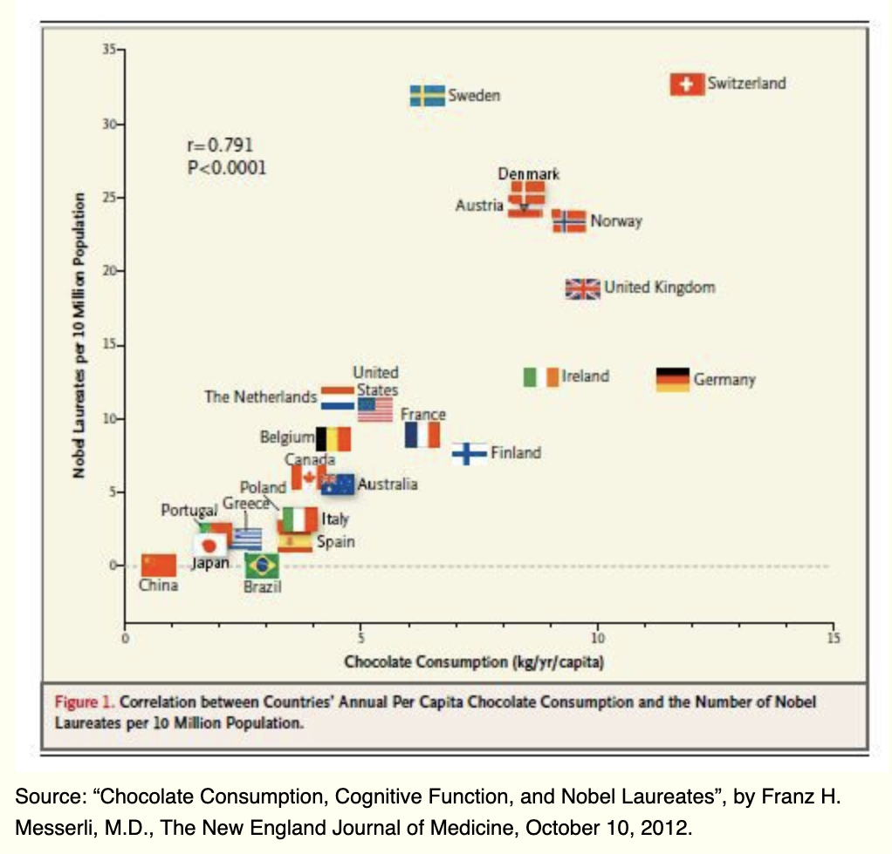
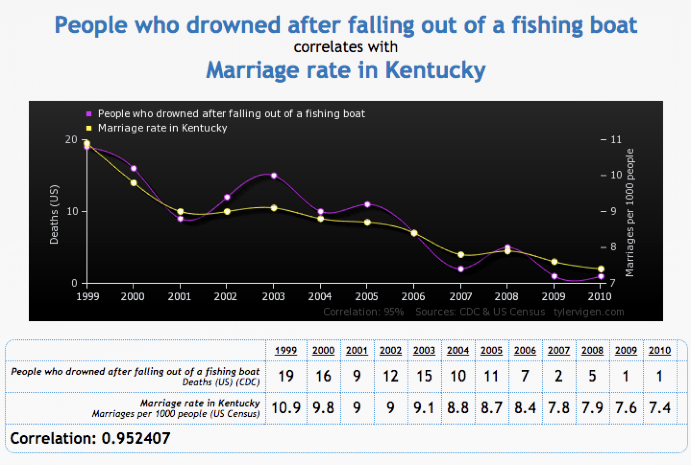
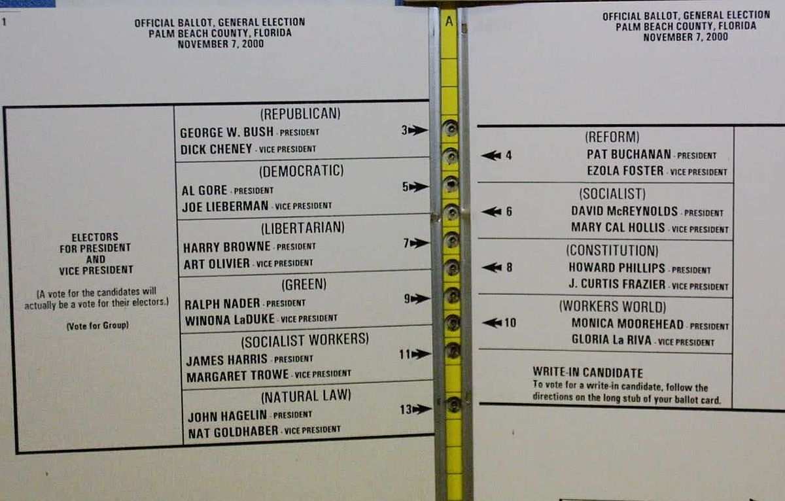

```{r setup, include=FALSE}
knitr::opts_chunk$set(eval = FALSE, echo = TRUE, message = FALSE, warning = FALSE)
```

# Today's Agenda: Learning Objectives

Three motivating questions:

- Did the butterfly ballot cost Al Gore the presidency?

- When are summaries misleading?

- Which party will win the 2026 midterms in the US House?

Terms and tools:

- Dependent and independent variables

- Correlation as a _mathematical summary of a scatterplot_

- Regression as a tool for prediction: `lm()` and `predict()`

- Correlation is not causation!

# Dependent and Independent Variables

- **Dependent variable** ($y$): the dependent/outcome/response variable. It goes on the *y*-axis.
- **Independent variable** ($x$): the independent/explanatory variable, or predictor. It goes on the *x*-axis.

When estimating a _causal effect_, we predict the outcome (Y) based on the treatment (X) - e..g, how much turnout changes as a result of getting a postcard, or being eligible for the Medicaid lottery.

More broadly, in **Social Science** we theorize about which independent variables $X$ cause/affect the dependent variable $Y$ (and how) and then "test" whether those theories are supported in the data by estimating the relationship and seeing if the direction and size of the relationship matches what our theories predict.

What makes something causal?  A persuasive argument (based on design?)

# Summarizing a Relationship, with a little math

Conceptually, the correlation coefficient describes, on average, how two variables _move together_ (in a linear way!).

<div style="text-align:center">
{width=70%}
</div>

See below for the math, if interested, but this is the formula:

$$
r_{xy} = \frac{1}{n-1}\sum_{i=1}^{n}
\left(\frac{x_i-\bar{x}}{s_x}\right)
\left(\frac{y_i-\bar{y}}{s_y}\right).
$$


In many ways, a correlation coefficient is **a mathematical summary of a scatterplot** -- i.e., `geom_point()`.

- **Positive correlation:** When $x$ is larger (lower) than its mean, $y$ is likely to be larger (lower) than its mean. The data cloud slopes up in `geom_point()`.

- **Negative correlation:** When $x$ is larger (lower) than its mean, $y$ is unlikely to be larger (lower) than its mean. The data cloud slopes down in `geom_point()`.

- **High correlation:** Data cluster "tightly" around a line through the scatterplot.

- **Low correlation:** Data cluster "loosely" around a line through the scatterplot.

Correlation $\neq$ Causation
  
<div style="text-align:center">
{width=50%}
</div>


# Elections and Palm Beach

<div class="alert alert-info">
**MOTIVATION QUESTION**
Did the butterfly ballot cost Al Gore the presidency?
</div>

Gore lost Florida, and with it the presidency, by 537 votes.

<div style="text-align:center">
{width=85%}
</div>

More narrowly: Patrick Buchanan received **3,407 votes** in Palm Beach County. Is that number strange?

Before we calculate anything:

- Strange compared with what?
- What would we need to know?
- What other candidate or election might give us a useful comparison?
- What would we expect to see if the Buchanan vote in Palm Beach was not unusual?
- Can we prove anything?

The recount that followed turned on punch-card ballots like this one.

<div style="text-align:center">
{height=320px} {height=320px}
</div>

# The Butterfly Ballot

## What Data Do We Have?

The data contain presidential election returns for Florida's 67 counties.

```{r}
library(tidyverse)
```

```{r}
florida = read.csv("florida.csv")
```

Always look at the data.

```{r}
glimpse(florida)
```

What does each row represent?

What do the variables measure?

Why might the number of votes for Ross Perot in 1996 help us understand the number of votes for Patrick Buchanan in 2000?

The comparison is not perfect. But voters who supported a third-party or minor-party candidate in one election may be more likely to do so in another. If that is true, counties with more Perot votes in 1996 should generally have more Buchanan votes in 2000.

What do you predict the relationship will look like?

## Look at the Relationship

We have two continuous variables. A scatterplot lets us see how they vary together across counties.

```{r, fig.width=8, fig.height=5.5}
flvotes = florida |>
  ggplot(aes(x = Perot96, y = Buchanan00)) +
  geom_point() +
  labs(
    title = "Florida County Level Voting Data",
    x = "Perot Votes, 1996",
    y = "Buchanan Votes, 2000"
  ) +
  theme_bw()

flvotes
```

What do you observe?

- Does the relationship move up or down?
- How tightly do the observations cluster?
- Is there anything strange?
- Can you tell which observation is Palm Beach?

## Summarize with Correlation

A correlation coefficient `cor()` summarizes a scatterplot.

```{r}
cor(florida$Perot96, florida$Buchanan00)
```

What does the positive sign tell us?

What does the number tell us?


## Useful Properties of Correlation

### Correlation is between -1 and 1

- $r = 1$: a perfect positive linear relationship.
- $r = -1$: a perfect negative linear relationship.
- $r$ near 0: very little **linear** relationship.

NOTE: A correlation of zero does not mean there is no relationship!!

### Order does not matter

The correlation is the same whether we write `cor(x, y)` or `cor(y, x)`.

```{r}
cor(florida$Perot96, florida$Buchanan00)
cor(florida$Buchanan00, florida$Perot96)
```

### Changing units does not change the correlation

Multiplying by a positive constant or adding a constant does not change the
correlation.

```{r}
cor(florida$Perot96, florida$Buchanan00)
cor(florida$Perot96 * 100,
    florida$Buchanan00 + 1000)
```

Changing from inches to centimeters or dollars to cents changes the scale. It does not change how tightly the observations follow the same line.

Multiplying one variable by a negative number, however, reverses the direction and
changes the sign.

```{r}
cor(florida$Perot96,
    florida$Buchanan00 * -1)
```

### Correlation measures linear association

Correlation tells us how closely the observations follow a straight-line relationship. It can miss a strong relationship that curves or takes some other shape.

```{r}
cor(florida$Perot96,
    florida$Buchanan00^2)
```

## What happens if we set Palm Beach aside?

So if we want to see if Palm Beach is weird, we want to focus on what the relationship should be -- assuming that it should be similar (cross-sectional comparison). Here we are asking whether Palm Beach follows the relationship shown by the other counties.

First, create a version of the data without Palm Beach using `filter`.

```{r}
florida_nopb = florida |>
  filter(county != "PalmBeach")
```

Now calculate the correlation again.

```{r}
cor(florida_nopb$Perot96,
    florida_nopb$Buchanan00)
```

With Palm Beach, the correlation is about 0.72. Without Palm Beach, it is about 0.92.  So that seems odd!

# Predicting Palm Beach with Regression

## How Do We Predict?

The correlation tells us how closely Perot's 1996 vote and Buchanan's 2000 vote move together.
It does not tell us:

- Where would Palm Beach fall if it followed the relationship among the other counties?
- How far is the observed Palm Beach vote from the line?
- How can we turn that line into a prediction?

Need to define a way to map from our independent variable (X) -- here Perot vote -- to our dependent variable (Y) --  here Buchanan vote.

For each value of X, I want to be able to generate a prediction for what Y should be given that value of X. So I give you X, and you tell me what you predict Y to be.

Let us try to fit a function to our data and use that function to generate predictions. If so, we can make predictions outside the values of the independent variable we observe, and we can use all of our data to help determine the relationship (not just the few observations associated with a particular value of X).

We will keep things simple and choose a function that is linear in its parameters:

\[
\widehat{Y}_i = \widehat{\alpha} + \widehat{\beta}X_i
\]

In terms of *interpretation*:

- $\alpha + \beta x_i$: predicted mean of $y_i$ given the value $x_i$
- $\alpha$: the predicted value of $y_i$ when $x_i = 0$
- $\beta$: how $y_i$ changes with a _one unit_ increase in $x_i$

Now plot!  Recall that we can add to our previously saved plot!

```{r, fig.width=8, fig.height=5.5}
flvotes + 
  geom_smooth(method = "lm")
```


## Analyze the Relationship with Regression

So let's now get into the details of that line that we just added!

To run the regression we use `lm()`. The outcome or dependent variable is on the left of `~`; the predictor or independent variable is on the right.

```{r}
florida.reg = lm(Buchanan00 ~ Perot96, data = florida)

florida.reg 
```

What does a _one unit_ increase in Perot vote mean for the Buchanan vote? 

Note that not only does the linear regression give us a *prediction* for Y given X, but crucially for social science it also gives a statement about the *relationship* between X and Y.

`predict()` gives the predicted values for the regression.

```{r}
predict(florida.reg)
```

We can also have it do this just for the data we want. Suppose we just want Palm Beach

```{r}
palm_beach = florida |>
  filter(county == "PalmBeach")

predict(florida.reg, newdata = palm_beach)
```

## Which Regression? With or Without Palm Beach

We now know that Perot's 1996 vote and Buchanan's 2000 vote are strongly related among the other Florida counties.

But our original question was more specific: How many Buchanan votes would we expect in Palm Beach if it followed that relationship?

Here we can use regression the same way we just did. So I give you X -- Perot's 1996 vote in Palm Beach -- and you tell me what you predict Y -- Buchanan's 2000 vote -- to be if Palm Beach followed the relationship among the other counties.  But what regression?

`florida.reg` used every county -- including Palm Beach. If we want to know what Palm Beach would look like if it followed the *other* counties, should Palm Beach help draw the line? Fit the same regression on the data without Palm Beach.

```{r}
florida.reg.nopb = lm(Buchanan00 ~ Perot96, data = florida_nopb)
```

How do they compare?

```{r}
florida.reg
florida.reg.nopb
```

Let's use the `predict()` function to make a prediction.  Since we are predicting data we already have, this is easy as we just need to name our `newdata`.

```{r}
predict(florida.reg, newdata = palm_beach)
predict(florida.reg.nopb, newdata = palm_beach)
```
How big was the difference?  How much larger was the vote we observed than the vote we would expect if voting in Palm Beach followed the pattern in other Florida counties?

```{r}
palm_beach$Buchanan00 - predict(florida.reg, newdata = palm_beach)
palm_beach$Buchanan00 - predict(florida.reg.nopb, newdata = palm_beach)
```
What does that tell you?  Recall that Gore lost Florida by 537 votes.  Does that prove anything?  Why or why not?

# A Complication: The Datasaurus Dozen

<div class="alert alert-info">
**MOTIVATION QUESTION**
When are summaries misleading?
</div>

Suppose I tell you that several datasets are nearly identical in terms of:

- Similar means for $x$ and $y$,
- Similar standard deviations for $x$ and $y$, and
- Very little correlation between $x$ and $y$.

What can you infer about their relationships?  

```{r}
datasaurus = read.csv("datasaurus.csv")

glimpse(datasaurus)
```

Now let's see how similar according to these summary statistics: both central tendency, variation, and relationship measured via a correlation.

```{r}
datasaurus |>
  group_by(dataset) |>
  summarize(
    mean_x = mean(x),
    mean_y = mean(y),
    sd_x = sd(x),
    sd_y = sd(y),
    correlation = cor(x, y)
  )
```

How different are these summaries?

Now let's look.

```{r, fig.width=9, fig.height=7}
datasaurus |>
  ggplot(aes(x = x, y = y)) +
  geom_point() +
  facet_wrap(~ dataset, ncol = 4) +
  labs(
    title = "Identical Summaries: Different Relationships"
  ) +
  theme_bw()
```

Visualization is key!


# Does Presidential Approval Affect House Elections?

<div class="alert alert-info">
**MOTIVATION QUESTION**
Which party will win the 2026 midterms?
</div>

The midterm election is one week away. Does an unpopular president hurt
their party's candidates for the House?

Here the independent variable is presidential approval: the percentage
approving of the president in the last Gallup poll taken in June of the
election year.

QUESTION: What should the dependent variable be? What would it mean for the
president's party to "do well" in a House election?

## What Data Do We Have?

```{r}
approvalvote = read.csv("approvalvote.csv")
```

Always look at the data.

```{r}
glimpse(approvalvote)
```

What does each row represent?

What do the variables measure? Note that Democrats held a House majority from 1955 through 1994!

Each row is one national election from 1946 to 2024 (20 midterms and 20
presidential elections). The House variables are all measured for the
**president's party**.

| Variable | Description |
|---|---|
| `Year` | Election year |
| `Election` | Type of election: `Midterm` or `Presidential` |
| `President` | President in June of the election year (1974 is Nixon, who resigned that August) |
| `Party` | President's party: `D` or `R` |
| `JuneApproval` | Percentage approving of the president in the last Gallup poll taken in June of the election year |
| `HouseVoteShare` | President's party's share (%) of the two-party national House vote |
| `HouseVoteChange` | `HouseVoteShare` minus the party's two-party House vote share two years earlier (percentage points) |
| `HouseSeatShare` | President's party's share (%) of all House seats |
| `HouseSeatChange` | Seats won by the president's party minus the seats it won two years earlier |
| `PresVoteShare` | President's party's share (%) of the two-party presidential vote; `NA` in midterm years |

*Quick Exercise* What are the possible Dependent Variables? What are you trying to predict/explain?

```{r}
# ANSWER?
```

*Quick Exercise* What are the possible Independent Variables? What are you using to predict/explain?

```{r}
# ANSWER?
```

## Look at the Relationship

If we are looking at the relationship between continuous variables what type of graph do we need?  

```{r}
# ANSWER?
```

Plot the relationship between the dependent variable and each independent variable you identify

```{r, fig.width=8, fig.height=5.5}
# ANSWER
```

What is the correlation for each? Does that make sense given the scatterplot?

```{r, fig.width=8, fig.height=5.5}
# ANSWER
```

## Analyze the Relationship with Regression

Choose the dependent variable that you think is most defensible.  (We have not talked about how to do this statistically yet, so make an argument as to which you think is most relevant)

To run the regression we use `lm()`. The outcome or dependent variable is on the left of `~`; the predictor or independent variable is on the right. Call it `house.reg`

```{r, fig.width=8, fig.height=5.5}
# house.reg = lm( ~ )
```

Gallup stopped doing presidential approval polls (why?), but we can still figure out what it might be by choosing possible values.

`predict()` gives the prediction for values of X that we choose.  What does this give as a prediction?

```{r}
predict(house.reg, newdata = tibble(JuneApproval = c(35, 40, 45)))
```


## Are Midterms Different?

In presidential years, the president (or their party's nominee) is on the ballot. In midterm years, the president is not. Should the relationship be the same?

Use scatterplots to see if the relationship is different. (NOTE: You can use `facet_wrap` to split a scatterplot by type of election, or you could `filter` -- there are lots of ways to do this.)

```{r, fig.width=9, fig.height=5}
# INSERT CODE
```

Now compute the correlation separately for each kind of election.  Here we can use our old friends `summarize` and also `group_by`

```{r}
# INSERT CODE
```

Where is the relationship stronger? 

NOTE: 1948 is very different: Truman's Democrats gained 75 seats with 40 percent approval!

*Quick Exercise* Make the single scatterplot and the faceted version with `HouseVoteChange` as the dependent variable, and calculate the correlation for each kind of election. Does the conclusion change?

```{r}
# INSERT CODE HERE
```

*Quick Exercise* Recalculate the correlation for presidential elections without 1948. How much does it change?

```{r}
# INSERT CODE HERE
```

## Predicting 2026

2026 is a midterm. If the relationship differs in midterms, a line estimated from all 40 elections may predict midterms poorly. Estimate the regression using only midterm elections.  You may need to create a new data object using `filter` and then call it into the regression using `data`:

```{r}
# midterm.reg
```

Now can you redo the prediction you did above?

```{r}
# INSERT CODE HERE
```

How do the slope, intercept, and predictions compare with the regression that used all 40 elections? Which would you use to forecast November?

```{r}
# INSERT CODE HERE
```

*Quick Exercise* Make your forecast and write it down: the approval value you used (and where it came from), which regression, the predicted seat change, the number of Republican seats (Republicans won 220 of 435 in 2024; 218 is a majority), and which party wins the House. On Wednesday we will make a second forecast from the votes in our class poll and compare the two.

```{r}
# INSERT CODE HERE
```


*EXTRA*  Repeat the comparison for the other dependent variables. For each, estimate the regression for all elections, for presidential elections, and for midterm elections. Do they give different answers?  Think about what the slope and intercept means given the different units being used!

```{r}
# INSERT CODE HERE
```

*EXTRA* Should we only look at more recent years? How would you do this? 

```{r}
# INSERT CODE HERE
```


# Correlation and Causation

**NOTE: If there is a causal relationship there will usually be a correlation, though it may be weak if the relationship is not linear. If there is a correlation that does not mean there is a causal relationship.**

It is human to see two variables moving together and construct a causal story. But the scatterplot and the correlation do not tell us why the variables move together.

Return to the Florida data:

- What is the observed relationship?
- What causal story are we tempted to tell?
- What evidence comes from the election design, ballot, and voting patterns
  rather than from the correlation itself?
- What can we conclude from this graph alone?

Correlation describes a relationship. A causal conclusion requires a research design and additional evidence.


## OPTIONAL: The Math Behind Correlation

The graph gives us the intuition. The mathematics tells us exactly what the
correlation is doing.

### Begin with distance from the mean

The mean of $x$ is

$$
\bar{x} = \frac{1}{n}\sum_{i=1}^{n}x_i.
$$

The sample variance of $x$ is the average squared distance from the mean:

$$
s_x^2 = \frac{1}{n-1}\sum_{i=1}^{n}(x_i-\bar{x})^2.
$$

The sample standard deviation of $x$ is the square root of the variance:

$$
s_x = \sqrt{s_x^2}.
$$

The standardized value, or $z$-score, for observation $i$ is

$$
z_{x_i} = \frac{x_i-\bar{x}}{s_x}.
$$

What does the sign of a $z$-score tell us?

- A positive value is above the mean.
- A negative value is below the mean.
- The size tells us how far the observation is from the mean in standard
  deviation units.

### Put the two variables together

The sample correlation coefficient is

$$
r_{xy} = \frac{1}{n-1}\sum_{i=1}^{n}
\left(\frac{x_i-\bar{x}}{s_x}\right)
\left(\frac{y_i-\bar{y}}{s_y}\right).
$$

That is: take the product of the standardized $x$ and $y$ values for every observation and add those products together.

- If $x_i$ and $y_i$ are both above their means, the product is positive.
- If $x_i$ and $y_i$ are both below their means, the product is also positive.
- If one is above its mean and the other is below, the product is negative.


# New R Functions Introduced in Session 16

Functions introduced in earlier sessions are intentionally omitted.

| Function or symbol | What it does |
|---|---|
| `cor()` | Calculates the correlation between two variables. |
| `lm()` | Estimates a linear regression of a dependent variable on an independent variable. |
| `predict()` | Uses an estimated regression to predict the dependent variable for new values. |

# Works Cited

Matejka, Justin, and George Fitzmaurice. 2017. “Same Stats, Different Graphs: Generating Datasets with Varied Appearance and Identical Statistics through Simulated Annealing.” *Proceedings of the 2017 CHI Conference on Human Factors in Computing Systems*, 1290–1294. <https://doi.org/10.1145/3025453.3025912>. The `datasaurus.csv` file is OpenIntro's copy of the data from the `datasauRus` R package. <https://www.openintro.org/data/index.php?data=datasaurus>.

Wand, Jonathan N., Kenneth W. Shotts, Jasjeet S. Sekhon, Walter R. Mebane Jr., Michael C. Herron, and Henry E. Brady. 2001. “The Butterfly Did It: The Aberrant Vote for Buchanan in Palm Beach County, Florida.” *American Political Science Review* 95(4): 793–810. The `florida.csv` file contains the county returns used in the paper.
