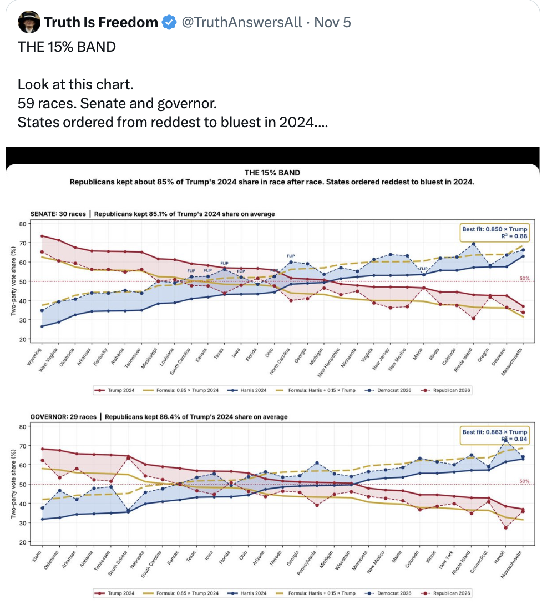
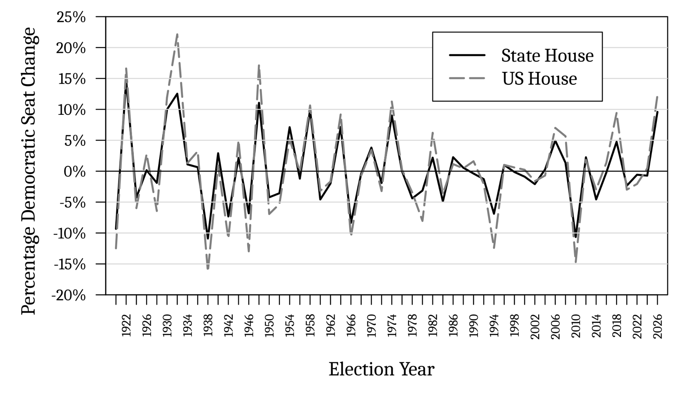
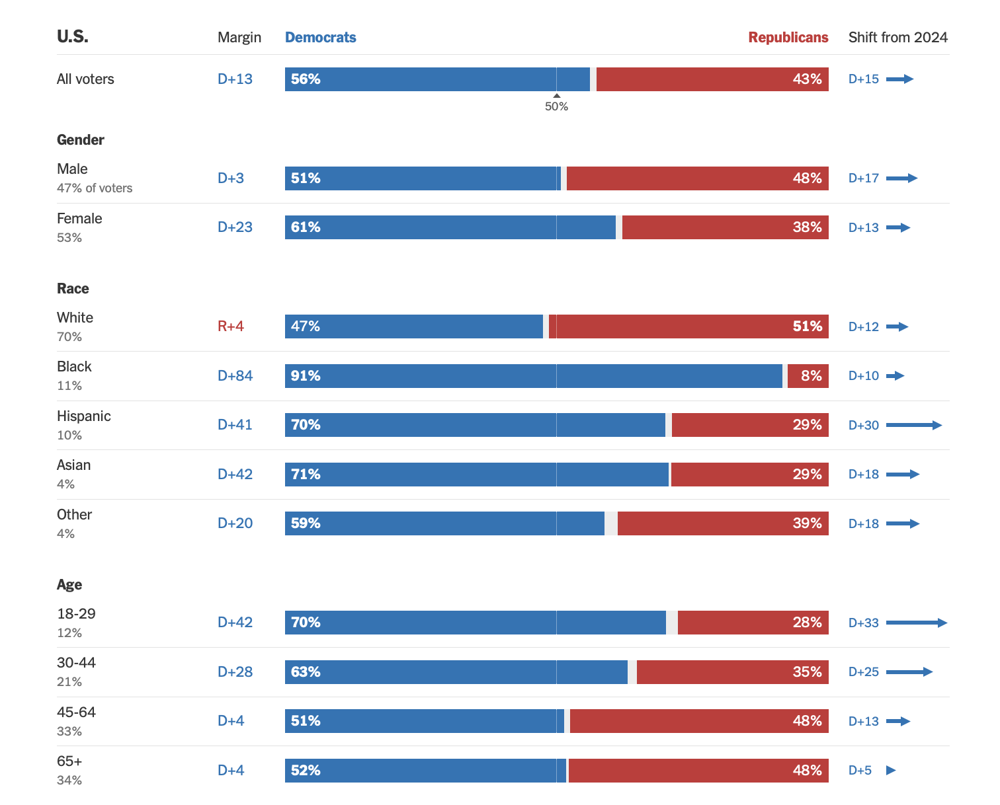

```{r setup, include=FALSE}
knitr::opts_chunk$set(eval = FALSE, echo = TRUE, message = FALSE, warning = FALSE)
```

# Today's Agenda: Learning Objectives

The election is over.  Before it, you made forecasts of the House using nothing more than a scatterplot, a line, and one number from a poll.  How close did they come?  Then we use the results to ask more questions.

Motivating questions:

- How close did our simple forecasts come?

- How did the polls do in Senate and governor races?

- Is a "too regular" election result suspicious?

- Does a bad midterm predict a bad presidential election?

Nothing here is new R!

# What Happened?

<div class="alert alert-info">
**MOTIVATION QUESTION**
How well did our "simple" analyses do?
</div>

```{r}
library(tidyverse)
```

Not every race has been called -- votes are still being counted (especially in California).  So we use NBC News's *projection* (as of November 6) of where the House will end up: **Democrats 259, Republicans 176**.

Republicans won 220 seats in 2024.  So Republicans lost 44 seats.

In the NBC News count as of November 6, Republicans have about 43.7% of the votes cast for the two major parties (Democrats are ahead by about 12 points).

The data from Sessions 16 and 17, with one new row: 2026.  Each row is an election; everything is for the president's party.

| Variable | Description |
|---|---|
| `Year` | Election year (1946-2026) |
| `Election` | `"Midterm"` or `"Presidential"` |
| `President` | President in June of the election year |
| `Party` | President's party (`"D"` or `"R"`) |
| `JuneApproval` | Percentage approving of the president in the last Gallup poll in June (missing for 2026) |
| `HouseVoteShare` | Share (%) of the two-party House vote |
| `HouseVoteChange` | Change in `HouseVoteShare` from the previous election |
| `HouseSeatShare` | Share (%) of House seats |
| `HouseSeatChange` | Change in the number of House seats from the previous election |
| `PresVoteShare` | Share (%) of the two-party presidential vote; missing in midterm years |

```{r}
approvalvote = read.csv("approvalvote2026.csv")

glimpse(approvalvote)
```

# Forecast #1: Approval to Seats

In Session 16 we predicted the change in House seats for the president's party from presidential approval, using past midterms.  We fit it on the elections *before* 2026 -- all we knew when we made the forecast.

```{r}
midterms = approvalvote |>
  filter(Election == "Midterm")

midterm.reg = lm(HouseSeatChange ~ JuneApproval, data = midterms)
```

In Session 17 we plugged in Trump's approval from our NBC News poll: 35.6% taking the poll at face value, and 41.0% after fixing the sample by party.

```{r}
220 + predict(midterm.reg, newdata = tibble(JuneApproval = c(35.6, 41.0)))
```

Republicans won (projected) 176.  One variable and the assumption of a a straight line through 20 midterms got us within4 to 9 seats of the actual outcome!

```{r, fig.width=8, fig.height=5.5}
midterms |>
  ggplot(aes(x = JuneApproval, y = HouseSeatChange)) +
  geom_hline(yintercept = 0) +
  geom_hline(yintercept = -44, color = "red", linetype = "dashed") +
  geom_point() +
  geom_smooth(method = "lm") +
  labs(
    x = "President's approval in June (%)",
    y = "Change in the president's party's House seats",
    title = "Red line: Predicted 2026 Republicans"
  ) +
  theme_bw()
```

# Forecast #2: The Generic Ballot to Seats

In Session 17 we also went from votes to seats.  What our NBC News poll said about the House vote, and what happened (Republican share of the two-party vote):

| | Republican share | Margin |
|---|---|---|
| NBC poll, raw (everyone who answered) | 41.0 | D+18 |
| NBC poll, fixed by party (46/46/8) | 46.9 | D+6 |
| Result (votes counted so far) | 43.7 | D+12 |

The votes-to-seats regression from Session 17, using the elections from 1996 through 2024.  Predictions at the raw poll, the fixed poll, and the actual vote:

```{r}
recent = approvalvote |>
  filter(Year < 2026 & Year >= 1996)

seats.reg.recent = lm(HouseSeatShare ~ HouseVoteShare, data = recent)

435 * predict(seats.reg.recent, newdata = tibble(HouseVoteShare = c(41, 46.9, 43.7))) / 100
```

Republicans won (projected) 176 seats, or 40.5%.  Where does 2026 fall?

# How Did the Polls Do?

<div class="alert alert-info">
**MOTIVATION QUESTION**
Our poll was off on the national vote.  Was that just our poll, or were the polls off everywhere?  And in which direction?
</div>

## What Data Do We Have?

Each row is a 2026 Senate or governor race.  For each race: the final polling average before Election Day and the result (votes counted so far).  All numbers are percentages; margins are Democrat minus Republican.

| Variable | Description |
|---|---|
| `office` | `"Senate"` or `"Governor"` |
| `state` | Two-letter state abbreviation |
| `dem_candidate`, `rep_candidate` | Candidates in the polling average (in Nebraska and South Dakota Senate, the independent is in the `dem` columns) |
| `poll_dem`, `poll_rep` | Final polling average (FiftyPlusOne) for the Democrat and the Republican; missing if the race had no average |
| `poll_margin` | `poll_dem` minus `poll_rep` |
| `result_dem`, `result_rep` | Share (%) of all votes counted for the Democrat and the Republican (NBC News) |
| `result_margin` | `result_dem` minus `result_rep` |
| `pct_counted` | Percentage of the expected vote counted so far |
| `three_way` | `TRUE` if a strong third candidate ran alongside both a Democrat and a Republican |
| `trump24` | Trump's share (%) of the two-party presidential vote in the state in 2024 |
| `notes` | Notes on the race |

```{r}
races = read.csv("statepolls2026.csv")

glimpse(races)

races |>
  count(office)
```

Always look at the data.  Are there races with no polling average?  Why might a race not be polled?

```{r}
races |>
  filter(is.na(poll_margin))
```

Three races were real three-way contests: a strong independent or third-party candidate ran alongside both a Democrat and a Republican (Montana Senate, Rhode Island governor, Wyoming governor).  Comparing Democrat versus Republican there misses the point of the race, so we set them aside.

```{r}
races = races |>
  filter(three_way == FALSE)
```

## Measuring Polling Error

Error = result minus poll.

- `dem_error` > 0: Democrats did *better* than the polls said (polls underpredicted Democrats).
- `rep_error` > 0: Republicans did *better* than the polls said (polls underpredicted Republicans).
- `margin_error` > 0: the margin was more Democratic than the polls said.

```{r}
races = races |>
  mutate(
    dem_error = result_dem - poll_dem,
    rep_error = result_rep - poll_rep,
    margin_error = result_margin - poll_margin
  )
```

On average, were the polls off -- and in which direction?

```{r}
races |>
  group_by(office) |>
  summarize(
    N = sum(!is.na(margin_error)),
    AvgDemError = mean(dem_error, na.rm = TRUE),
    AvgRepError = mean(rep_error, na.rm = TRUE),
    AvgMarginError = mean(margin_error, na.rm = TRUE)
  )
```

QUESTION: Why can both `dem_error` and `rep_error` be positive in the same race?

## Plotting the Errors

```{r, fig.width=8, fig.height=4.5}
races |>
  ggplot(aes(x = margin_error)) +
  geom_histogram(binwidth = 2) +
  geom_vline(xintercept = 0, color = "red") +
  facet_wrap(~ office) +
  labs(
    x = "Polling error in the margin (result minus final average, D - R)",
    y = "Number of races"
  ) +
  theme_bw()
```

*Quick Exercise* Make the same histogram for `dem_error` and then `rep_error`.  Did the polls miss more by getting Democrats wrong or Republicans wrong?

QUESTION: If polling errors were just random sampling error, what would these histograms look like?

# A Graph From the Day After

<div class="alert alert-info">
**MOTIVATION QUESTION**
This graph was posted on November 5th and reposted by President Trump on Nov 7th.  It suggests that Republicans getting about 85% of Trump's 2024 share "in race after race" is suspicious -- too regular to be real.  Is it?
</div>



NOTE: For how this graph spread and why it was persuasive, see Center for an Informed Public, University of Washington. 2026. ["'Proof' of a 'stolen election': How misleading charts lend credibility to election fraud rumors."](https://www.cip.uw.edu/2026/11/10/misleading-charts-credibility-election-fraud-rumors/) November 10.

## What Is Wrong With This Graph?

We know humans love to see patterns and infer causality in relationships.  So let's think about some visualization choices that were made.

QUESTION: What is on the x-axis?  How is it scaled?

QUESTION: What do the lines connecting the states mean?

## A Better Graph

The claim is about the relationship between two variables: how Trump did in a state in 2024, and how the Republican did in 2026.  Those are two continuous variables and we have a graph for that - scatterplot!

We use the same races as before, with the three-way races set aside.  `trump24` is Trump's share of the two-party vote in 2024.  We need the Republican share of the two-party vote in 2026, and the share of Trump's vote the Republican "kept."

```{r}
races = read.csv("statepolls2026.csv") |>
  filter(three_way == FALSE) |>
  mutate(
    rep26 = 100 * result_rep / (result_dem + result_rep),
    kept = rep26 / trump24
  )
```

```{r, fig.width=9, fig.height=4.5}
races |>
  ggplot(aes(x = trump24, y = rep26)) +
  geom_abline(intercept = 0, slope = 1, linetype = "dashed") +
  geom_text(aes(label = state)) +
  geom_smooth(method = "lm") +
  facet_wrap(~ office) +
  labs(
    x = "Trump's share 2024 (%)",
    y = "Republican share 2026 (%)",
    title = "Two Party Vote Share: 2024 vs 2026"
  ) +
  theme_bw()
```

Was it really 85% "in race after race"?

```{r}
races |>
  group_by(office) |>
  summarize(
    Correlation = cor(trump24, rep26),
    AvgKept = mean(kept),
    MinKept = min(kept),
    MaxKept = max(kept)
  )
```

## Why Would Every State Look the Same?

### What Voters Told Us

Our NBC News poll asked people how they voted in 2024 and how they would vote for the House in 2026.  Each row is a respondent.  The variables we use:

| Variable | Description |
|---|---|
| `vote2024` | How the respondent says they voted in 2024: `"Trump"`, `"Harris"`, `"Someone else"`, `"Did not vote"`, or `"Not eligible"` |
| `generic_ballot` | How they would vote for the House in 2026: `"Democrat"` or `"Republican"` |
| `state` | Two-letter state abbreviation |

```{r}
poll = read.csv("midterm2026_poll_clean.csv")
```

We split respondents into three groups by their 2024 vote: Trump, Harris, and Neither (did not vote, voted for someone else, or not eligible).

```{r}
poll = poll |>
  mutate(vote24 = case_when(
    vote2024 == "Trump" ~ "Trump",
    vote2024 == "Harris" ~ "Harris",
    TRUE ~ "Neither"
  ))

poll |>
  group_by(vote24) |>
  summarize(
    N = n(),
    PctRep = 100 * mean(generic_ballot == "Republican")
  )
```

Is that different from state to state?  If Trump voters in red states and blue states behave the same way, the share voting Republican should not depend on how Trump did in their state.  Trump's 2024 share in every state:

| Variable | Description |
|---|---|
| `state` | Two-letter state abbreviation |
| `trump24` | Trump's share (%) of the two-party presidential vote in the state in 2024 |

States with at least 30 respondents in the group:

```{r}
trump2024 = read.csv("trump2024_bystate.csv")

bystate = poll |>
  group_by(vote24, state) |>
  summarize(
    N = n(),
    PctRep = 100 * mean(generic_ballot == "Republican")
  ) |>
  filter(N >= 30) |>
  left_join(trump2024, by = "state")
```

```{r, fig.width=10, fig.height=4.5}
bystate |>
  ggplot(aes(x = trump24, y = PctRep)) +
  geom_point(aes(size = N)) +
  geom_smooth(method = "lm") +
  facet_wrap(~ vote24) +
  labs(
    x = "Trump's share of the two-party vote in the state, 2024 (%)",
    y = "% voting Republican for the House, 2026",
    size = "Respondents"
  ) +
  theme_bw()
```

# What Does 2026 Tell Us About 2028?

<div class="alert alert-info">
**MOTIVATION QUESTION**
Republicans lost 44 seats.  Does a bad midterm for the president's party predict a bad presidential election two years later?
</div>

## What Data Do We Have?

Each row is a midterm election and everything is coded relative to the president's party:

| Variable | Description |
|---|---|
| `Year` | Year of the midterm |
| `President` | President at the time of the midterm |
| `Party` | President's party (`"D"` or `"R"`) |
| `HouseSeatChange` | Change in House seats in the midterm |
| `HouseVoteChange` | Change in House vote share in the midterm |
| `PresVoteBefore` | Share of the two-party presidential vote two years *before* the midterm |
| `PresVoteAfter` | Share of the two-party presidential vote two years *after* the midterm |
| `PresVoteChange` | `PresVoteAfter` minus `PresVoteBefore` |

So for 2018: Republicans lost 42 seats; Trump won 48.9% of the two-party vote in 2016 and 47.7% in 2020, a change of -1.2.

```{r}
midterm_pres = read.csv("midterm_pres2026.csv")

midterm_pres
```

## Correlation

```{r}
cor(midterm_pres$HouseSeatChange, midterm_pres$PresVoteChange)

cor(midterm_pres$HouseSeatChange, midterm_pres$PresVoteChange,
    use = "complete.obs")
```

Why does the first `cor()` give `NA`?  Because `PresVoteChange` is missing for 1946 and 2026 we must add the `use = "complete.obs"` so that we only analyze midterm elections with both variables.

## Scatterplot

Before calculating anything, lets plot and observe!  Do you see a relationship?

```{r, fig.width=8, fig.height=5.5}
midterm_pres |>
  ggplot(aes(x = HouseSeatChange, y = PresVoteChange)) +
  geom_point() +
  labs(
    x = "Pres's party's House midterm seat change",
    y = "Pres's party pres. vote share change two years later"
  ) +
  theme_bw()
```

## Regression

Now let's turn that correlation and relationship into a prediction using linear regression.

```{r}
pres.reg = lm(PresVoteChange ~ HouseSeatChange, data = midterm_pres)

pres.reg
```

How do we interpret the slope? Intercept? What does losing 10 more seats in the midterm predict for the presidential vote two years later?

What does the model predict for Republicans in 2028?  Republicans won 50.7% of the two-party vote in 2024.

```{r}
predict(pres.reg, newdata = tibble(HouseSeatChange = -44))

50.7 + predict(pres.reg, newdata = tibble(HouseSeatChange = -44))
```

## Since 1996

As before, maybe politics has changed since House elections became competitive.  Let's reconsider using the relationship starting in 1996:

```{r}
recent_pres = midterm_pres |>
  filter(Year >= 1996)

cor(recent_pres$HouseSeatChange, recent_pres$PresVoteChange,
    use = "complete.obs")

pres.reg.recent = lm(PresVoteChange ~ HouseSeatChange, data = recent_pres)

pres.reg.recent

50.7 + predict(pres.reg.recent, newdata = tibble(HouseSeatChange = -44))
```

## Careful: What Did the Election "Mean"?

Republicans lost 44 seats.  It is very, very tempting to read that as a verdict -- on a policy, a candidate, or a message.  Humans love to infer causality.  A lession from this class is: Be careful!

**When everything moves together, look for something common.**  State legislative elections and U.S. House elections tend to move together: when the president's party loses House seats, it usually loses state legislative seats too.  These are different offices, different candidates, and different issues -- so if they move together, the likely explanation is something they share: a reaction to the party in power nationally.  In *Accountability in State Legislatures* (University of Chicago Press, 2023), Steven Rogers (a former student of mine!) shows that most voters do not know who their state legislator is, and that state legislators are rewarded or punished for how voters feel about the president rather than for their own records.  We saw the same thing in the Senate and governor races: the same swing, nearly everywhere.



But it is not just offices -- it is also voters.  In the 2026 exit poll, _every_ demographic group moved toward Democrats compared to 2024!



Remember the "Obama coalition"? (Probably not as you were still toddlers!) Or how about the "Trump coalition" that everyone was talking about after 2024 and how Trump has remade the Republican party? Turns out, not so much. Electoral coalitions among voters seem to break as quickly as they are "made."  Maybe that is because they were never really made in the first place!  When every group moves in the same direction, the election is telling us about a common reaction -- not about a new and lasting coalition.  Coalitions may exist mostly in the minds of pundits and politicians, who cannot help but overinterpret election results.

QUESTION: After an election, someone says "voters rejected X" or "voters rewarded Y."  What would you need to know to believe it?

QUESTION: Is this a mandate for Democrats (or Republicans) to do X?
